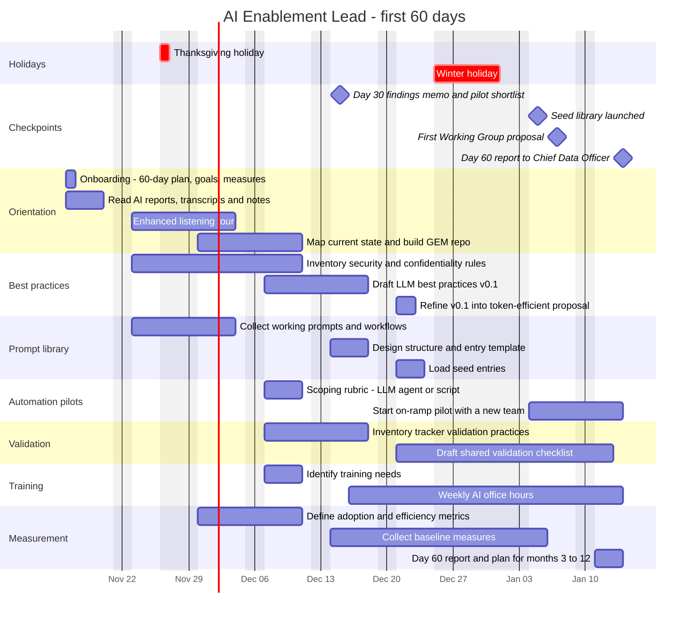

# AI Enablement Lead: first 60 days

**Role:** AI Enablement Lead (12-month secondment)
**Reports to:** Maisie Bird, Chief Data Officer
**Period:** Monday, November 16, 2026 to Thursday, January 14, 2027 (Day 60)

Every task below comes from a duty or qualification in the job ad, or from my own notes on it. Work that doesn’t fit in 60 days is listed under After Day 60.

## Timeline

## Phases

| Phase | Dates | Focus |
| --- | --- | --- |
| Days 1–30 | Nov 16 – Dec 15 | Listen and map: meet every team, understand current AI use, agree goals and metrics |
| Days 31–60 | Dec 16 – Jan 14 | Build and start: first best practices, seed library, first pilots, Day 60 report |

GEM holidays in this window are November 26 and 27, and December 25 – January 1. The chart skips those days and weekends. The second half has three working weeks: Dec 16–24 and Jan 4–14.

## Task tracker

Tick the boxes as you go; GitHub renders them as checkboxes.

### Orientation and stakeholder map

| Done | Task | Dates | Grounded in |
| --- | --- | --- | --- |
| [ ] | Onboarding: set up a 60-day plan including goals, success measures | Nov 16–17 | Communications and reports to the Chief Data Officer |
| [ ] | Read documents below: • AI & Automation listening tour summary reports • Gemini interview auto transcripts • AI working group Gemini notes • AI task inventory task type • GEM’s framework for human-centered research (request access) • Organize Automation folder | Nov 16–20 | Support implementation of GEM’s AI-related work |
| [ ] | Enhanced listening tour: • ask opinions about web interface review options (not using spreadsheet in the intermediate transition) • ask quality control practice • identify pilot trackers, tracker “champions” | Nov 23 – Dec 4 | Works with every program and department; on-ramp for teams not yet using AI |
| [ ] | Map current state: • who uses which tools, for what, with what checks • build “GEM repo” to add all the skills in one place | Nov 30 – Dec 11 | Track and document adoption across teams |
| [ ] | **Milestone:** Day 30 findings memo and pilot shortlist | Dec 15 | Checkpoint |

### Best practices and governance

| Done | Task | Dates | Grounded in |
| --- | --- | --- | --- |
| [ ] | Inventory existing guidance on data security, confidentiality, provenance and embargoed data | Nov 23 – Dec 11 | Sound judgment about data security, confidentiality and provenance |
| [ ] | Draft LLM best practices v0.1, covering hallucination, inconsistency and limits of automation | Dec 7–18 | Develop and promote best practices for LLMs |
| [ ] | Refine v0.1 into a decision-ready proposal with high-efficient use of tokens | Dec 21–23 | Bring concrete proposals to the Working Group |
| [ ] | **Milestone:** First proposal to the AI & Automation Working Group | Jan 7 | Checkpoint |

### Shared prompt and workflow library

| Done | Task | Dates | Grounded in |
| --- | --- | --- | --- |
| [ ] | Collect working prompts, agent instructions and workflows during the enhanced listening tour | Nov 23 – Dec 4 | Build and maintain GEM’s shared library in github |
| [ ] | Design library structure and entry template (purpose, tool, inputs, failure modes, validation, owner, last-tested date) | Dec 14–18 | Same duty |
| [ ] | Load seed entries | Dec 21–24 | Same duty |
| [ ] | **Milestone:** Seed library launched | Jan 5 | Checkpoint |

### Automation opportunities and pilots

| Done | Task | Dates | Grounded in |
| --- | --- | --- | --- |
| [ ] | Scoping rubric and intake form: LLM agent for unstructured text, or script/pipeline for structured data | Dec 7–11 | Scope automation opportunities and steer each to the right tool |
| [ ] | Start an on-ramp pilot with a team not yet using AI | Jan 4–14 (continues) | On-ramp for teams not yet using AI or automation |

### Validation and quality

| Done | Task | Dates | Grounded in |
| --- | --- | --- | --- |
| [ ] | Inventory how tracker teams validate AI-assisted work today | Dec 7–18 | Coordinate validation practices with tracker teams |
| [ ] | Draft a shared validation checklist with tracker teams | Dec 21 – Jan 13 | Ensure products maintain high quality |

### Training and enablement

| Done | Task | Dates | Grounded in |
| --- | --- | --- | --- |
| [ ] | Identify training needs by audience (new, regular, power users) | Dec 7–11 | Teaching, facilitation and plain-language writing |
| [ ] | Run weekly AI office hours and log the questions | Dec 16 – Jan 14 | Translate between technical and non-technical colleagues |

### Measurement and reporting

| Done | Task | Dates | Grounded in |
| --- | --- | --- | --- |
| [ ] | Define adoption, efficiency and quality metrics with the Chief Data Officer; confirm funder needs (?) | Nov 30 – Dec 11 | Track adoption and efficiency outcomes for funder reporting |
| [ ] | Collect baseline measures before pilots start | Dec 14 – Jan 6 | Same duty |
| [ ] | Day 60 report: progress, early outcomes, plan for months 3–12 | Jan 11–14 | Same duty |
| [ ] | **Milestone:** Day 60 report to the Chief Data Officer | Jan 14 | Checkpoint |

## After Day 60 (Need to update)

These were in the 90-day version and move to the next phase:

- Publish best practices v1.0 after Working Group feedback
- Re-validation protocol for when models change
- First workshop series on plain-language basics and failure modes
- Recruit one AI champion per team
- Library maintenance rhythm and per-team owners
- Finish the on-ramp pilot and document it as a library entry
